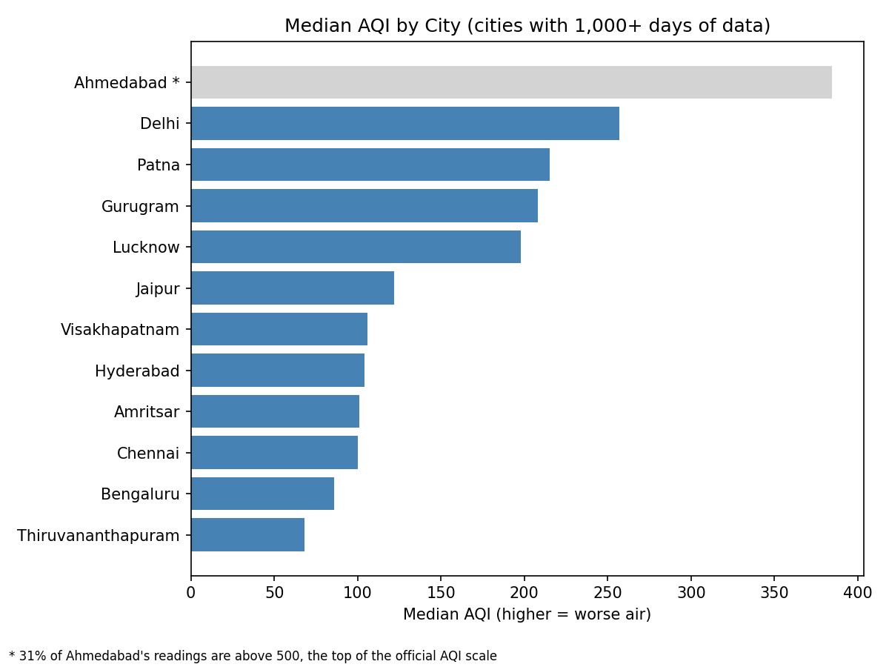
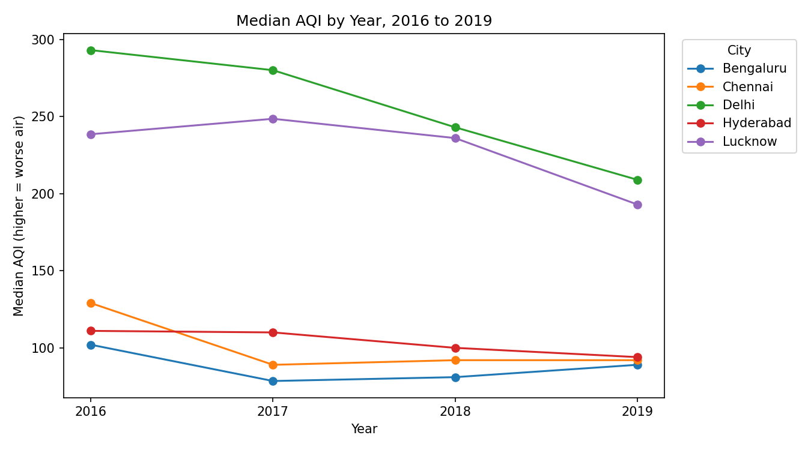
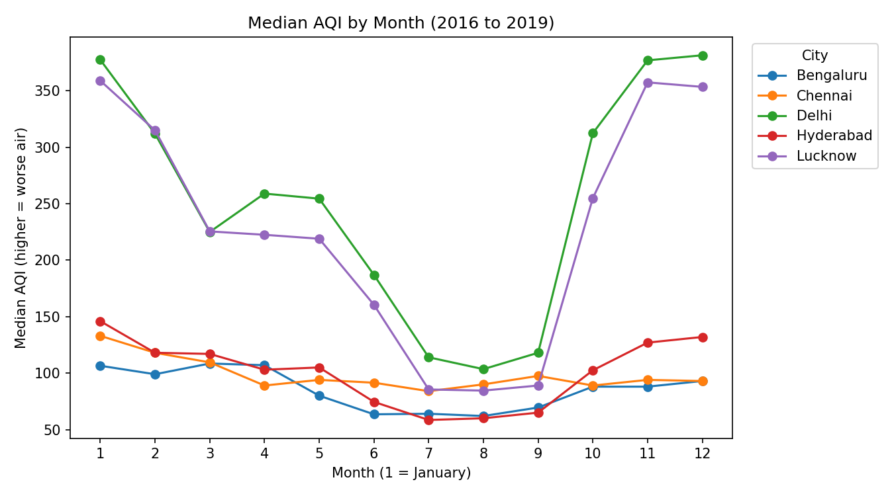
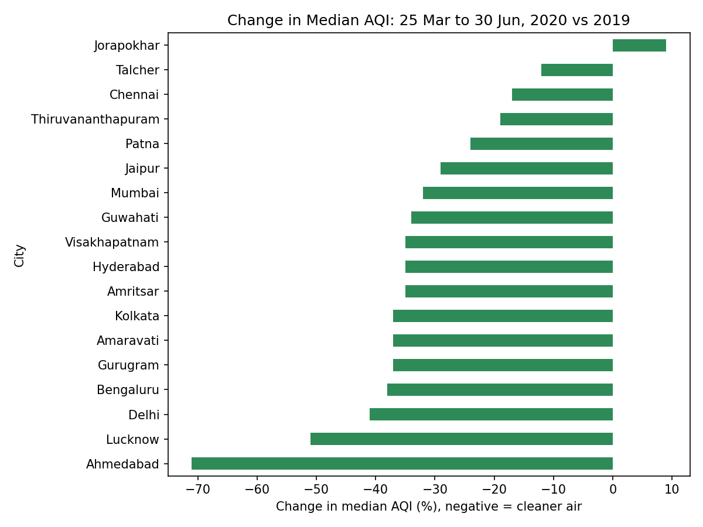

# Air Quality in Indian Cities (2015-2020)

A Python analysis of daily air quality (AQI) data for 26 Indian cities. A higher AQI means worse air.

## Questions I asked
1. Which cities have the worst air?
2. Has air quality improved over the years?
3. Which months are the worst?
4. What happened during the 2020 lockdown?

## Key findings

### 1. Which cities have the worst air?

- Among cities with reliable data, Delhi has the highest median AQI (257), followed by Patna (215), Gurugram (208) and Lucknow (198). Thiruvananthapuram (68) and Bengaluru (86) are the cleanest.
- Ahmedabad ranks first (384), but I flagged it: 412 of its 1,334 readings (31%) are above 500, the top of the official AQI scale, so its data looks unreliable.

### 2. Has air quality improved?

I compared 2016 to 2019 for the 5 cities with 300+ days of data in every year. Median AQI fell in all five: Delhi 293 to 209 (-29%), Chennai 129 to 92 (-29%), Lucknow 238 to 193 (-19%), Hyderabad 111 to 94 (-15%) and Bengaluru 102 to 89 (-13%). Delhi is still the most polluted of the five.

### 3. Which months are the worst?

Delhi and Lucknow are worst from October to February and cleanest in July and August. Delhi's median AQI is 382 in December and 104 in August (about 3.7 times worse). Lucknow's is 359 in January and 84 in August (about 4.3 times worse). The southern cities change much less through the year.

### 4. What happened during the 2020 lockdown?

I compared 25 March to 30 June 2020 with the same dates in 2019, using cities with 60+ days of data in both periods. 17 of 18 cities had a lower median AQI in 2020 (16 of 17 if Ahmedabad is left out). Only Jorapokhar was higher (+9%). The biggest drops were Lucknow (-51%) and Delhi (-41%).

This shows the air was cleaner in those weeks. It does not prove the lockdown caused it, because air quality was already improving each year and weather differs between years.

## Data
Kaggle "Air Quality Data in India (2015 - 2020)" (city_day.csv): https://www.kaggle.com/rohanrao/air-quality-data-in-india

29,531 rows, 26 cities, January 2015 to July 2020. 24,850 rows have an AQI value.

## How I cleaned and checked the data
- Xylene is empty in 61% of rows, so I dropped it.
- There were no duplicate rows.
- I did not fill empty cells with averages, because cities differ too much. For AQI questions I used only rows with a real AQI value.
- I used the median instead of the average, because it is less affected by extreme readings.
- Cities are only compared when they have enough data: 1,000+ days for the city ranking, 300+ days in each year for the yearly trend, and 60+ days in both periods for the lockdown comparison.
- Ahmedabad's AQI readings look unreliable (31% above the top of the scale), so I flagged it and did not use it for conclusions.

## Limitations
- This analysis shows what changed, not why.
- I used the AQI values as given in the dataset and did not check how each city calculated them.
- The yearly trend covers only 5 cities, because few cities have complete data.

## Tools
Python (pandas, matplotlib) in Google Colab.

## Files
- **air_quality_analysis.ipynb**: the full notebook with code and explanations
- **q1_city_aqi.png, q2_yearly_trend.png, q3_monthly_pattern.png, q4_lockdown_change.png**: the four charts
